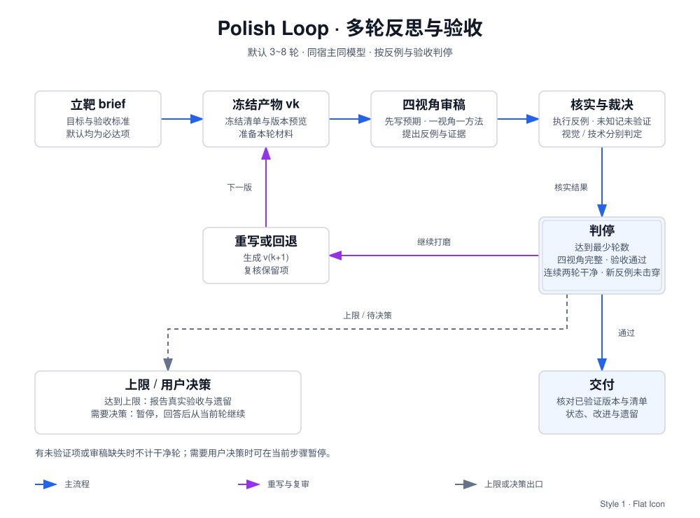
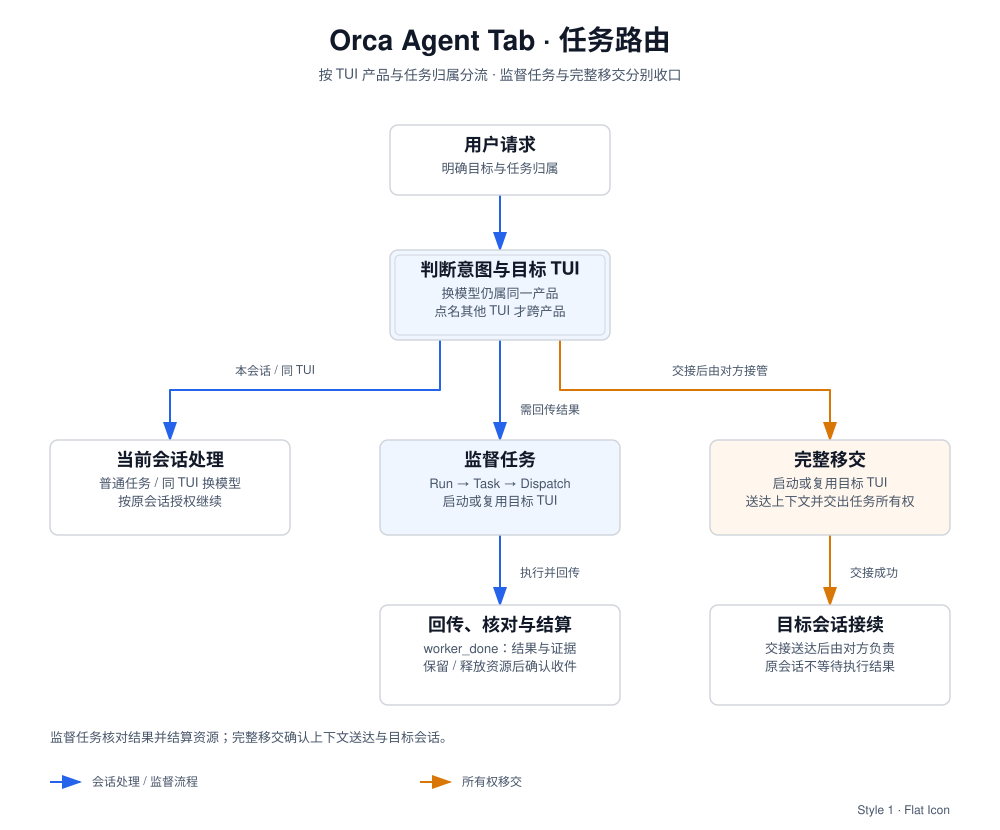

# agent-workflows

> **以 Skill 形式提供 Agent 协作、复核与运行维护工作流。**
> 覆盖单模型多视角打磨、跨 Agent 的任务派发与交接，以及运行环境的受控更新；通过相对软链供本地宿主读取。

本仓库收录可复用的协作、质量检查与运行维护流程；运行维护以已安装工具的受控更新及行为保留为范围。`doc-to-sketch` 等文档出图、业务查询或其他独立生产能力继续独立维护，按具体任务调用。

---

## 一、技能选型矩阵 (Skill Selection Matrix)

| 技能 | 解决什么问题 | 使用边界 |
| --- | --- | --- |
| [**polish-loop**](skills/workflows/polish-loop/SKILL.md) | 对方案、文档、代码、视觉产物或 Prompt 多轮审稿、反例验证与改进 | 显式调用；同宿主同模型；可用时隔离子代理审稿；视觉验收需实际预览 |
| [**orca-agent-tab**](skills/orchestration/orca-agent-tab/SKILL.md) | 把任务交给另一 TUI：监督并收回结果，或完整移交所有权 | 需要 Orca 与可用的目标 TUI；按用户指定目标和任务归属派发 |
| [**orca-update**](skills/maintenance/orca-update/SKILL.md) | 受控更新 Orca 或已安装、正在使用的 AI CLI，复查原有行为 | 按用户授权执行；先看时只读；动态发现入口与网络策略，保留既有账号、会话与 HUD／hook 集成 |

使用示例：

- 在已安装 Skill 的宿主中：`/polish-loop 打磨这份方案，重点检查遗漏和可执行性。`
- 在 Orca 会话中，目标 CLI 已配置时，可使用以下请求：

```text
请让 <审计工具 A>、<审计工具 B> 分别审计以下改动：
对比范围：<基准提交> 到 <目标提交>
文件范围：<文件或目录>

两方独立审查，互不参考对方结论。
分别给出审计结论、问题位置、依据及影响；单列未验证事项。
请核实依据并汇总意见，本轮完成后返回结论，等待我确认。
本轮仅限只读审计，不修改文件、提交或推送。
```

审查未提交改动时，先确认文件清单、本轮 diff 及未跟踪新文件的内容；审计期间内容变化，应重新确认范围。
不同审计工具不保证使用不同模型；需要跨模型审计时，应明确指定模型。

---

## 二、架构与设计哲学 (Architecture & Philosophy)

### 1. `polish-loop`：多轮反思与验收



流程依次为：
1. 立靶：写验收标准，挑选适用的不变量提示；
2. 冻结版本清单；
3. 四个视角审稿，每个视角配一种检查方法；
4. 主持人串行执行反例，核实后裁决；
5. 重写或回退；
6. 交付时核对已验证的版本。

轮数默认 3~8 轮；没有干净子上下文时为 3~5 轮。收敛须同时满足以下条件：
- 四个视角的结果完整；
- 验收标准与适用不变量全部满足，涉及它们的未验证项已经闭合；
- 连续两轮没有阻断或重要问题；
- 最后一轮新增的反例去重后达到下限，并且全部执行、全部未击穿。

达到上限时，如实报告验收结果；需要用户决策时暂停。

#### 设计原则

- **换取证路径，不只换视角名**：同一个模型只换视角名，盲区不变。所以每个视角各配一种检查方法：需求倒推、读实现、看产物、异常序列、不变量核对、故障注入或删句测试。确认轮保留反方，以及证据或验证视角，并至少换一条取证路径。
- **先写预期，再看产物**：预期写成「前置条件 → 操作 → 可观察结果」。同会话做不到盲审时，如实注明。
- **反例为准，未知不清零**：判停看反例统计与验收，不看自评分。核实不了的问题标为未验证，不能驳回了事。
- **证据绑定版本**：每轮冻结受验文件清单；新增的检查要证明会因目标行为而失败；交付前核对交付的就是验证过的那一版。
- **不变量是提示，不是新需求**：同源、可逆、去重与幂等、目标隔离、失败收尾、只读边界、检查有效。帮助发现遗漏，但不自动扩大范围。
- **只用自己**：本 Skill 不调用其他模型或 CLI。发现超出自审能力的风险时，写进报告，由用户决定是否另行安排跨模型审计。

---

### 2. `orca-agent-tab`：跨 TUI 监督与交接



- **核心原则**：换模型不换产品，点名另一个 TUI 才跨产品；加载不等于开标签，交互不等于全托管。
- **监督任务**：通过 Run / Task / Dispatch 追踪，核对 `worker_done` 的结果与证据，再决定保留或释放资源、确认收件。修改文件清单与报告路径仅在实际存在时提供。
- **完整移交**：上下文送达、目标会话明确后交出任务所有权，原会话不再等待结果；无需建立监督任务。

---

### 3. `orca-update`：运行环境受控维护

根据当前安装、实际入口和用户范围确定更新目标，保留各工具原有代理或直连、账号与启动语义，并分层验证版本、会话及受影响的自定义集成。需要目标工具已安装，并能核对其实际更新渠道；涉及 Orca 宿主状态时，采用该版本提供的能力。

加载 Skill 不会自动执行更新，也不会为宿主自行发起的更新增加后台验收。网络值、路径、账号及版本基线在执行时发现并留在本机；静态校验与真实升级验收分别记录。

更新涉及已有 HUD／statusline 时，按需读取[既有显示集成的维护](skills/maintenance/orca-update/references/hud-statusline-maintenance.md)，关联适配器源码与原生协议，保留用户显示偏好并复用离线自检；安全降级与完整验收通过分别报告。

---

## 三、快速开始与本地安装 (Installation)

适用于支持软链的 macOS / Linux 环境，需要 Bash 和 Python 3。

### 1. 验证与同步软链

```bash
git clone https://github.com/Li-Sanze/agent-workflows.git
cd agent-workflows

# 1. 静态规范与隐私扫描 (验证通过后方可安装)
./scripts/check.sh

# 2. 预览即将建立的软链
./scripts/sync-links.sh --dry-run --target /path/to/host/skills

# 3. 执行真实安装 (幂等更新)
./scripts/sync-links.sh --target /path/to/host/skills
```

### 2. 指定同步目标

将示例路径替换为仓库位置和宿主实际配置的技能目录。`--target` 必填，可重复指定多个目标；路径含空格时加引号。

```bash
./scripts/sync-links.sh --target /path/to/first/skills --target "/path/to/second host/skills"
```

脚本从自身位置确定仓库，并自动扫描 `skills/<分类>/<技能名>/SKILL.md`。同步目标由调用方提供，按实际宿主配置选择。

### 3. 安全冲突保护机制

- **相对软链**：链接直接指向仓库源码，不写入个人绝对路径；单独移动仓库后，按原目标目录重新运行同步命令。
- **冲突保护**：遇到同名真实文件或目录时，脚本会在任何写入前整体验证并报错；已有软链按需逐个原子替换。

收录源码与迁移已有安装分开处理。目标已存在独立维护的同名 Skill 时，真实目录会阻止整批同步，已有软链则可能被改指仓库版；先核对实际来源，再按用户授权迁移，保留原目录及未提交修改。安装收据、HUD 清单和机器基线留在本机，不随 Skill 源码入库。

---

## 四、仓库结构与开发规范 (Structure & Guidelines)

```text
agent-workflows/
├── LICENSE                             # MIT 开源许可证
├── README.md                           # 仓库全景、设计哲学、安装与选型索引
├── .gitignore                          # 标准忽略 (屏蔽过程稿、测试产物与 DS_Store)
├── assets/                             # 视觉呈现与架构矢量图 (fire skill 渲染)
│   ├── polish-loop-flow.svg            # Generator-Critic 多轮反思流程图
│   └── orca-routing-flow.svg           # 跨 TUI 协同拓扑图
├── scripts/                            # 工具套件
│   ├── sync-links.sh                   # 将相对软链同步到指定目录
│   └── check.sh                        # 质量门禁：结构、隐私路径、Shell 语法全项检查
└── skills/                             # 技能源码分类收纳
    ├── workflows/                      # 单宿主产物打磨与复核
    │   └── polish-loop/
    │       ├── SKILL.md
    │       ├── references/
    │       │   ├── lenses.md           # 4 视角库与同会话隔离模板
    │       │   └── rubrics.md          # 6 类任务质量清单
    │       └── agents/
    │           └── openai.yaml
    ├── orchestration/                  # 【编排协作类】多 Agent 协同与跨宿主调度
    │   └── orca-agent-tab/
    │       └── SKILL.md
    └── maintenance/                    # 已安装工具的受控更新与行为保留
        └── orca-update/
            ├── SKILL.md
            ├── agents/
            │   └── openai.yaml
            └── references/
                ├── discovery-and-evidence.md
                └── hud-statusline-maintenance.md
```

### 贡献与新增技能规范

1. **收录边界**：`workflows/` 放单宿主产物打磨与复核；`orchestration/` 放跨 TUI 协作与任务交接；`maintenance/` 放已安装工具的受控更新与行为保留。按真实复用需求增加工作流。
2. **名称与布局**：使用 `skills/<分类>/<技能名>/`，名称在所有分类中唯一，并与 frontmatter 的 `name` 一致。
3. **按需扩展**：新增目录并更新选型索引即可被同步脚本发现；各 Skill 自带需要的 `references/`、`scripts/`、`assets/`，说明依赖和验收方式。
4. **路径可迁移**：源码使用相对路径或参数，避免开发者机器的个人绝对路径；宿主安装目录通过 `--target` 提供。
5. **提交前检查**：运行 `./scripts/check.sh`；它覆盖基础结构、隐私路径和软链行为，各 Skill 的功能仍按自身验收方式检查。

---

## 五、开源许可 (License)

本项目采用 [MIT License](LICENSE) 授权。
