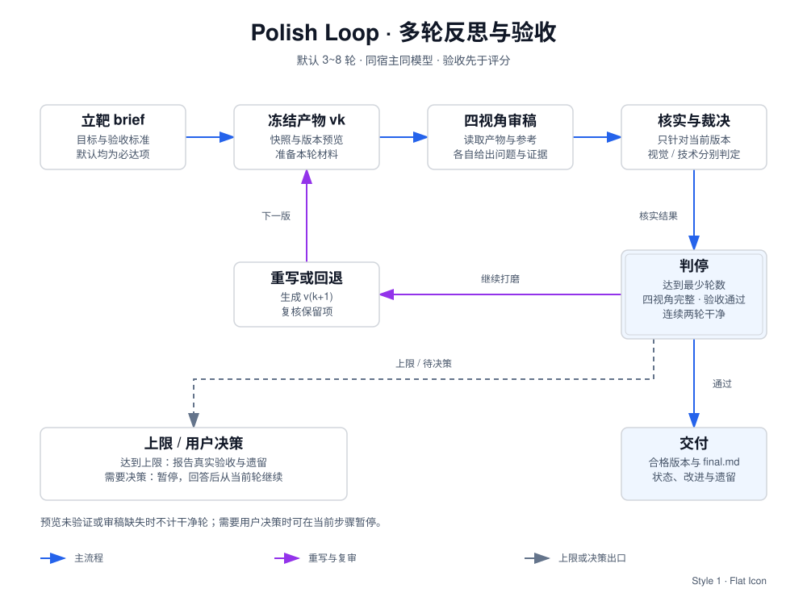
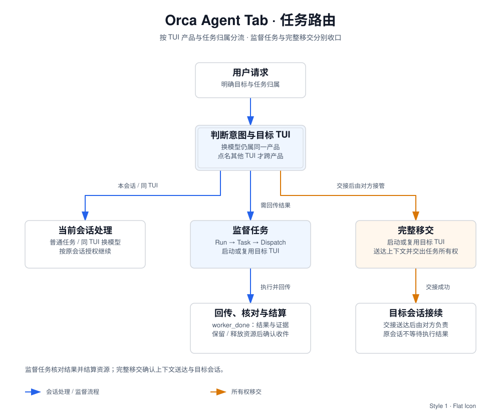

# agent-workflows

> **以 Skill 形式提供 Agent 协作与复核工作流。**
> 覆盖单模型多视角打磨，以及跨 Agent 的任务派发、交接与验收；通过相对软链供本地宿主读取。

本仓库收录可复用的协作与质量检查流程。`doc-to-sketch` 等文档出图、业务查询或其他独立生产能力继续独立维护，按具体任务调用。

---

## 一、技能选型矩阵 (Skill Selection Matrix)

| 技能 | 解决什么问题 | 使用边界 |
| --- | --- | --- |
| [**polish-loop**](skills/workflows/polish-loop/SKILL.md) | 对方案、文档、代码、视觉产物或 Prompt 多轮审稿与改进 | 显式调用；同宿主同模型；可用时隔离子代理审稿；视觉验收需实际预览 |
| [**orca-agent-tab**](skills/orchestration/orca-agent-tab/SKILL.md) | 把任务交给另一 TUI：监督并收回结果，或完整移交所有权 | 需要 Orca 与可用的目标 TUI；按用户指定目标和任务归属派发 |

使用示例：

- 在已安装 Skill 的宿主中：`/polish-loop 打磨这份方案，重点检查遗漏和可执行性。`
- 在 Orca 会话中，目标 CLI 已配置时，可使用以下请求：

```text
请让 <审计工具 A>、<审计工具 B> 分别审计以下改动：
对比范围：<基准提交> 到 <目标提交>
文件范围：<文件或目录>

两方独立审查，互不参考对方结论。
分别给出审计结论、问题位置、依据及影响；单列未验证事项。
请核实依据并汇总意见，本轮完成后返回结论，等待我确认。
本轮仅限只读审计，不修改文件、提交或推送。
```

审查未提交改动时，先确认文件清单、本轮 diff 及未跟踪新文件的内容；审计期间内容变化，应重新确认范围。
不同审计工具不保证使用不同模型；需要跨模型审计时，应明确指定模型。

---

## 二、架构与设计哲学 (Architecture & Philosophy)

### 1. `polish-loop`：多轮反思与验收



流程包括立靶、冻结版本、四视角审稿、核实裁决、重写或回退。默认 3~8 轮：四视角完整、适用验收全部通过且连续两轮无阻断或重要问题时才收敛；达到上限如实报告验收结果，需要用户决策时暂停。视觉与技术状态分别记录，审稿失败或截断不能计为干净轮。

#### 设计原则

- **批判与核实**：意见附原文、画面定位、命令结果或清楚的推理，由主持人核实后采纳。
- **反馈与回归**：对照当前冻结版和此前保留项决定如何修改；两轮干净是经验性判停规则。
- **视角独立**：审稿人获取任务和产物，不继承作者理由或此前裁决；同会话角色切换需注明。
- **减法与范围**：优先解决影响验收的问题，减少冗余；结构问题才考虑重做或回退。
- **验证有边界**：仅验证视角执行适用测试；视觉判定基于实际画面，未验证项如实标注。

---

### 2. `orca-agent-tab`：跨 TUI 监督与交接



- **核心原则**：换模型不换产品，点名另一个 TUI 才跨产品；加载不等于开标签，交互不等于全托管。
- **监督任务**：通过 Run / Task / Dispatch 追踪，核对 `worker_done` 的结果与证据，再决定保留或释放资源、确认收件。修改文件清单与报告路径仅在实际存在时提供。
- **完整移交**：上下文送达、目标会话明确后交出任务所有权，原会话不再等待结果；无需建立监督任务。

---

## 三、快速开始与本地安装 (Installation)

适用于支持软链的 macOS / Linux 环境，需要 Bash 和 Python 3。

### 1. 验证与同步软链

```bash
git clone https://github.com/Li-Sanze/agent-workflows.git
cd agent-workflows

# 1. 静态规范与隐私扫描 (验证通过后方可安装)
./scripts/check.sh

# 2. 预览即将建立的软链
./scripts/sync-links.sh --dry-run --target /path/to/host/skills

# 3. 执行真实安装 (幂等更新)
./scripts/sync-links.sh --target /path/to/host/skills
```

### 2. 指定同步目标

将示例路径替换为仓库位置和宿主实际配置的技能目录。`--target` 必填，可重复指定多个目标；路径含空格时加引号。

```bash
./scripts/sync-links.sh --target /path/to/first/skills --target "/path/to/second host/skills"
```

脚本从自身位置确定仓库，并自动扫描 `skills/<分类>/<技能名>/SKILL.md`。同步目标由调用方提供，按实际宿主配置选择。

### 3. 安全冲突保护机制

- **相对软链**：链接直接指向仓库源码，不写入个人绝对路径；单独移动仓库后，按原目标目录重新运行同步命令。
- **冲突保护**：遇到同名真实文件或目录时，脚本会在任何写入前整体验证并报错；已有软链按需逐个原子替换。

---

## 四、仓库结构与开发规范 (Structure & Guidelines)

```text
agent-workflows/
├── LICENSE                             # MIT 开源许可证
├── README.md                           # 仓库全景、设计哲学、安装与选型索引
├── .gitignore                          # 标准忽略 (屏蔽过程稿、测试产物与 DS_Store)
├── assets/                             # 视觉呈现与架构矢量图 (fire skill 渲染)
│   ├── polish-loop-flow.svg            # Generator-Critic 多轮反思流程图
│   └── orca-routing-flow.svg           # 跨 TUI 协同拓扑图
├── scripts/                            # 工具套件
│   ├── sync-links.sh                   # 将相对软链同步到指定目录
│   └── check.sh                        # 质量门禁：结构、隐私路径、Shell 语法全项检查
└── skills/                             # 技能源码分类收纳
    ├── workflows/                      # 单宿主产物打磨与复核
    │   └── polish-loop/
    │       ├── SKILL.md
    │       ├── references/
    │       │   ├── lenses.md           # 4 视角库与同会话隔离模板
    │       │   └── rubrics.md          # 6 类任务质量清单
    │       └── agents/
    │           └── openai.yaml
    └── orchestration/                  # 【编排协作类】多 Agent 协同与跨宿主调度
        └── orca-agent-tab/
            └── SKILL.md
```

### 贡献与新增技能规范

1. **收录边界**：`workflows/` 放单宿主产物打磨与复核；`orchestration/` 放跨 TUI 协作与任务交接。按真实复用需求增加工作流。
2. **名称与布局**：使用 `skills/<分类>/<技能名>/`，名称在所有分类中唯一，并与 frontmatter 的 `name` 一致。
3. **按需扩展**：新增目录并更新选型索引即可被同步脚本发现；各 Skill 自带需要的 `references/`、`scripts/`、`assets/`，说明依赖和验收方式。
4. **路径可迁移**：源码使用相对路径或参数，避免开发者机器的个人绝对路径；宿主安装目录通过 `--target` 提供。
5. **提交前检查**：运行 `./scripts/check.sh`；它覆盖基础结构、隐私路径和软链行为，各 Skill 的功能仍按自身验收方式检查。

---

## 五、开源许可 (License)

本项目采用 [MIT License](LICENSE) 授权。
